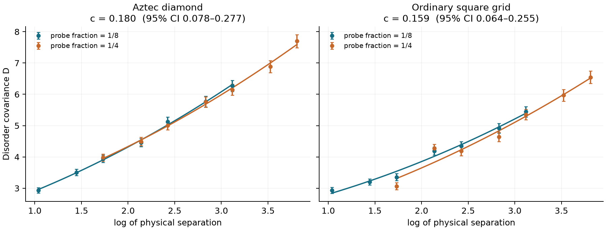

# Random-weight dimers: Aztec diamonds and square grids

We study whether random edge weights produce a **squared-log contribution to
spatial height fluctuations** in the Aztec diamond and on an ordinary square grid.

The completed experiment uses the same Gamma weight law in both geometries:
independent families with shapes **0.2 and 0.25**, scale one, and the other
families fixed at one. Two independent tilings share each fixed environment.
Their height-increment covariance measures the disorder contribution.

## What we found

Across sizes **16–128**, both geometries show a positive fitted squared-log term:

| Geometry | Coefficient of `(log r)²` | 95% bootstrap interval |
|---|---:|---:|
| **Aztec diamond** | **0.17994** | **[0.07819, 0.27740]** |
| **Ordinary square grid** | **0.15882** | **[0.06446, 0.25529]** |

The campaign contains **258,048 paired environments**, including controls.
All 504 sampling batches passed raw-data verification. Uncertainty uses 10,000
bootstrap resamples of whole environments, keeping both replicas and probes together.



These are **positive finite-range numerical signals**. Fits restricted to
32–128 or 48–128 have intervals including zero, so the experiment does not
establish an asymptotic law or prove the physics conjecture. The joint control
test gives `p=0.2039`; one individual control interval narrowly excludes zero
and is retained in [the full results](docs/RESULTS.md).

## Reproduce the analysis

Python **3.11+** is sufficient to analyse the included data; Julia is needed
only for simulation and its tests.

```bash
make setup-python
make analysis
```

This verifies the published data checksums, recomputes the moments and all
18 fitted coefficients, and writes tables and a figure to `output/analysis/`.
The quick command uses the recorded bootstrap intervals. To independently
rerun the fixed 10,000 resamples and 9,999 control permutations:

```bash
make bootstrap
```

See [the short analysis guide](analysis/README.md) for the equations, code flow
and output files. All **516,096 measurement rows** are included in
[data/](data/README.md), alongside the plan, seeds, verification provenance,
recorded results and the exact Hamilton source snapshot.

## Code and documentation

| Path | Purpose |
|---|---|
| [analysis/](analysis/) | One readable analysis entry point and data export |
| [data/](data/README.md) | Completed paired measurements and reproducibility records |
| [aztec/](aztec/) | Julia shuffling sampler, geometry, numerical audits and tests |
| [square_glauber_python/](square_glauber_python/) | Python square sampler, Glauber/CFTP implementations and tests |
| [docs/METHODS.md](docs/METHODS.md) | Model, coordinates, sampling and statistical conventions |
| [docs/RESULTS.md](docs/RESULTS.md) | All fixed windows, controls and limitations |
| [docs/research/handbook.typ](docs/research/handbook.typ) | Definitions and the complete research history; `make handbook` builds its PDF |
| [docs/AI_CONTRIBUTIONS.md](docs/AI_CONTRIBUTIONS.md) | Recorded AI assistance and outstanding human review |

The completed campaign used **corrected shuffling**, including a square region
embedded in an Aztec host. The historical Gamma sampler had an orientation
mismatch; the corrected path passes small exact-distribution tests. Float64
reduction arithmetic has documented numerical qualifications. Read
[the methods](docs/METHODS.md) before making exactness claims.

```bash
make test-python       # Python mathematical and workflow tests
make setup-julia       # Julia 1.10+
make test-julia        # Julia tests and command-line workflows
```

Historical reports are in [docs/history/](docs/history/). Earlier large archives,
local runs and downloads are excluded from the current Git checkout and remain
available locally and in earlier Git revisions. Full tiling arrays remain on
Hamilton; the included measurements are sufficient to reproduce every reported
analysis. Generated outputs and local environments are ignored by Git.
