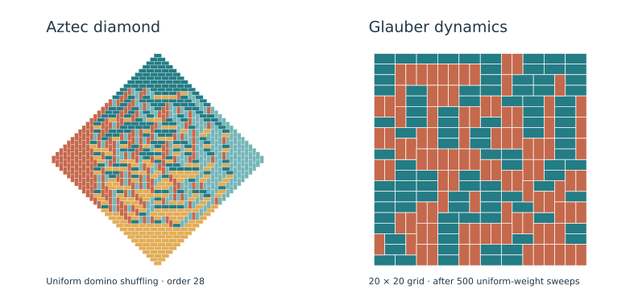
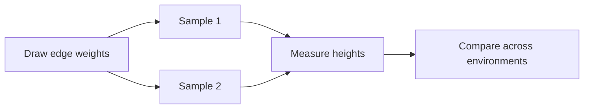

# Random tilings & Glauber dynamics

Research code for **Aztec-diamond tilings** and **square-grid dimer dynamics**.
We study how random edge weights affect the fluctuations of a tiling's height.



## Two active projects

| Project | What it does | Language |
| :--- | :--- | :--- |
| [Aztec](aztec/) | Samples weighted domino tilings by shuffling; measures central heights and spatial increments. | Julia |
| [Glauber dynamics](square_glauber_python/) | Evolves square-grid dimers by local heat-bath updates; also provides exact small-grid checks and coupling-from-the-past sampling. | Python |

The Julia package also keeps a tested Glauber implementation and Kasteleyn
calculations for reference. Older spanning-tree, Temperley, and random-walk
experiments live in [archive/](archive/INDEX.md).

## Start here

Run these commands from the repository root. Use **Julia 1.10+** for Aztec
and **Python 3.12 or 3.13** for the Python setup below. Each project can be
used independently.

**Aztec — generate one small tiling**

```bash
make setup-julia
make demo-aztec
```

Open `aztec/output/demo/tiling_mathematica_style.svg` to see the result.
The folder also contains the sampled weights, tiling matrix, and run metadata.

**Glauber — run a small dynamics example**

```bash
make setup-python PYTHON=python3.13
make demo-glauber
```

The example compares two starting states on an 8 × 8 grid. Traces, diagnostic
figures, and summaries are written to `square_glauber_python/outputs/demo/`.
This short run demonstrates the workflow; it does not establish mixing.

```bash
make test-julia       # Julia unit tests and small end-to-end workflows
make test-python      # Python mathematical and workflow tests
make validate-python # Exact tiny-grid checks
```

Use `make help` for all shortcuts. Both demos use fixed seeds.

## How it works

A **dimer** pairs two neighbouring grid vertices; it can be drawn as a domino.
Glauber dynamics chooses a square face and, when possible, redraws its two
dimers. Edge weights set the probabilities. An unchanged draw still counts
as an update.


To separate sampling fluctuations from disorder, draw two independent samples
in the **same fixed environment**, then repeat across environments:



The research question is whether the disorder contribution grows like
`log(L)` or includes a `log(L)²` term. The code tests this question; the
illustrations above are examples, not evidence for a scaling law.

## Where things live

```text
research/
├── README.md                start here
├── Makefile                 setup, examples, and tests
├── aztec/                   Julia source, tests, configs, data, and HPC scripts
├── square_glauber_python/   Python source, tests, configs, and HPC scripts
├── docs/                    methods and reproducible README figures
└── archive/                 earlier experiments, reports, notes, and local runs
```

New outputs stay in `aztec/output/` or `square_glauber_python/outputs/` and are
ignored by Git. Existing datasets used by the Julia analysis remain in
`aztec/data/`. Past results and the provisional September report are indexed
in the archive; their original qualifications still apply.

For more detail: [methods and conventions](docs/METHODS.md) ·
[Python command reference](square_glauber_python/PROJECT_GUIDE.md) ·
[Julia workflows](aztec/scripts/COMMANDS.md) ·
[archive index](archive/INDEX.md).

The figures are generated from the code with `make figures`; their
[source and seeds](docs/scripts/render_figures.py) are included.
